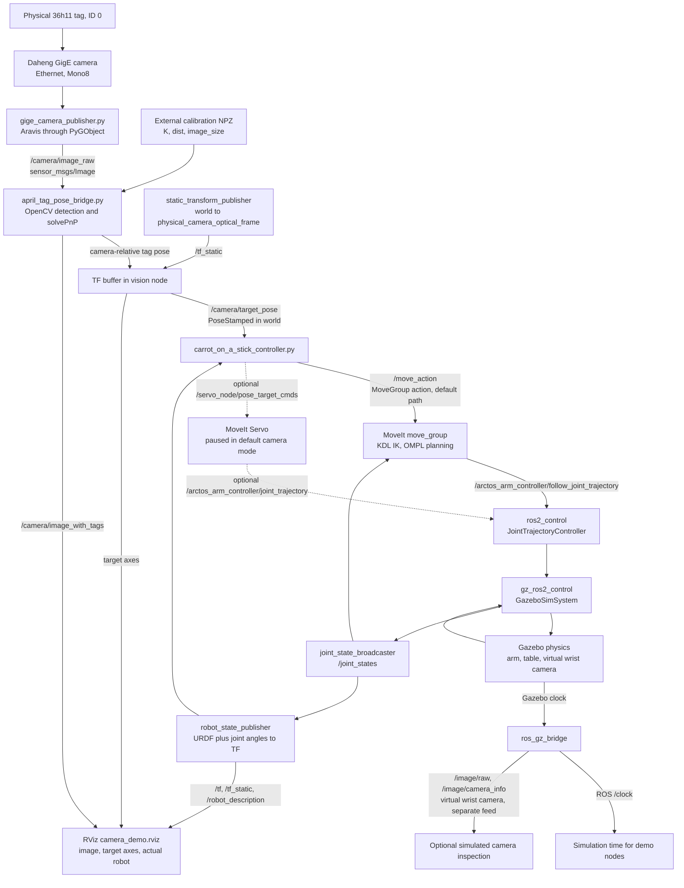

# Camera demo: architecture, every repository file, and reproduction guide

This guide explains how the physical Daheng monochrome camera drives the simulated Arctos arm, what was added or changed, and how to run and diagnose the demo.

## Scope and reading order

The repository covered here is **`~/Developer/Astro/arctos_arm`**, on branch **`camera_demo`**. It contains six ROS packages under `ros2_ws/src`. The file catalog below covers every Git-tracked file, including binary assets and the two tracked Python cache files. Generated build/install/log trees and untracked cache files are explained separately. It does not attempt to document every file in the surrounding `Astro` directory; the external calibration inputs used by this demo are explicitly documented.

The camera implementation is committed in **`a257459`**, “Add camera demo ROS2 control logic and AprilTag pose bridge.” **Created** and **Modified** refer to that commit compared with its parent, **`3d0f080`**. This distinction matters because a clean working tree does not mean these files were always present. This guide itself is a new documentation artifact written after that implementation.

Suggested order:

1. Read the system overview and diagrams to understand the data flow.
2. Read the camera coordinate mapping before changing the static transform.
3. Follow the reproduction instructions to run the current demo.
4. Read the created-file and modified-file analyses for implementation details.
5. Use the complete file catalog when exploring the repository.

## 1. High-level overview

A physical printed AprilTag is a visual target. The physical camera sees it. OpenCV identifies its four corners and estimates a six-degree-of-freedom pose using known tag size and calibrated camera intrinsics. TF converts that pose from camera coordinates into the simulated world's coordinates. The carrot controller asks MoveIt to move the simulated end effector to that target.

The existing motion controller is reused: changing its target source does not require replacing its motion-planning stack. The camera demo routes the bridge output and controller input to **`/camera/target_pose`**. The generic figure-eight demo still uses **`/desired_pose`**. The camera view deliberately has no draggable MoveIt goal controls.

**The physical tag does not move the printed tag model on the simulated table.** That model is static scenery. The detected target is represented by axes in RViz and drives the arm's `Link_6_1` target pose. There is no camera-driven Gazebo marker object and no direct assignment of arm joint angles from image coordinates.

The default camera launch uses **planning only** (`servo_distance:=0.0`). It plans and executes discrete trajectories rather than continuously servoing. The Servo process still starts and is initialized/paused because the controller's startup expects it. `servo_distance:=0.25` restores the optional plan-to-Servo handoff, with the singularity limitations encountered during testing.

### Architecture: runtime data and control



Solid planning connections are the default motion path. Dashed Servo connections are used only when the positive handoff distance is enabled. TF is a coordinate relationship, not a device that moves the camera.

### Architecture: launch composition

```mermaid
flowchart TD
    USER["Terminal 1: measured static camera transform"]
    MAIN["Terminal 2: camera_demo.launch.py"]
    MAIN --> GROUP["Scoped GroupAction\nkeeps nested launch settings local"]
    GROUP --> CARROT["carrot_demo.launch.py\nfigure_eight=false\nrviz=false\ntarget_topic=/camera/target_pose"]
    CARROT --> SIM["gazebo_moveit.launch.py"]
    CARROT --> SERVO["servo_node"]
    CARROT --> CTRL["carrot controller"]
    SIM --> GZ["Gazebo and robot spawn"]
    SIM --> RSP["robot_state_publisher"]
    SIM --> BRIDGE["Gazebo to ROS clock/image bridge"]
    SIM --> SPAWN["controller_manager spawner"]
    SIM --> MG["move_group"]
    MAIN --> CAMERA["Physical GigE camera publisher"]
    MAIN --> VISION["AprilTag pose bridge"]
    MAIN --> RVIZ["Dedicated RViz camera view"]
    USER --> VISION
```



The old MoveIt RViz window is disabled inside the included launch. The dedicated camera RViz window is controlled by the outer `rviz` argument. Keeping the include inside `GroupAction(scoped=True)` prevents its `rviz=false` from disabling the outer viewer too.

## 2. Technologies and why each is present

| Technology | Role in this repository | Why the camera demo needs it |
|---|---|---|
| ROS 2 Jazzy | Nodes, topics, services, actions, discovery, parameters and launch files | Separates image capture, vision, coordinate conversion, motion and visualization into communicating processes. |
| DDS / ROS middleware | Underlying node-to-node delivery and discovery | Carries ROS messages. Image streams use sensor-data QoS; correct reliability settings matter for subscribers. |
| `rclpy` / `rclcpp` | Python ROS client library / C++ client library | Custom nodes are Python; MoveIt, controllers, TF utilities and RViz largely run compiled code. |
| GigE Vision / GenICam | Camera streaming and feature configuration over Ethernet | Allows Aravis to open the Daheng camera, set pixel format/rate, and retrieve frames. |
| Aravis 0.8, `gi`, PyGObject | Camera library and its Python binding | The active ROS camera publisher uses this stack, rather than the Galaxy `gxipy` SDK. |
| Galaxy tools / `gxipy` | Camera vendor tools and SDK used by external `VA_Test` scripts | Useful for network setup and calibration capture. Not required by the active ROS bridge. |
| OpenCV `cv2.aruco` | AprilTag-family marker recognition, corner extraction, annotation | Turns the image into identifiable tag corners. This is not a separately installed AprilTag detector package. |
| OpenCV `solvePnP`, IPPE square | Known-size planar square pose estimation | Uses corner locations, tag size, intrinsics and distortion to recover metric rotation/translation. [OpenCV PnP reference](https://docs.opencv.org/4.9.0/d5/d1f/calib3d_solvePnP.html) |
| NumPy / `.npz` | Numeric matrices and serialized calibration | Stores/loads `K`, distortion coefficients, image size and computes rotations/offsets. |
| `cv_bridge` | Conversion between `sensor_msgs/Image` and OpenCV arrays | Lets the detector operate on ROS images and publish an annotated image back. |
| TF2, `tf2_ros`, `tf2_geometry_msgs` | Time-indexed relationships between coordinate frames | Converts a camera-relative tag pose to the same world frame used by MoveIt. The geometry import registers PoseStamped transforms. |
| URDF / Xacro | Robot links, joints, collision/inertial geometry and parameterized model composition | Gives Gazebo, TF and MoveIt a consistent mechanical model. Xacro expands reusable camera/table/control macros. |
| SRDF | Semantic robot definitions: groups, named states, end effector, disabled collision pairs | Tells MoveIt what joints form the arm and which collisions should be considered. |
| MoveIt 2 / `move_group` | IK, planning scene, constraints, motion planning and execution | Converts the target end-effector pose into a collision-checked trajectory. |
| KDL kinematics plugin | Inverse kinematics for `arctos_arm` | Determines whether joint configurations can produce the requested pose. |
| OMPL / RRTConnect | Path planning algorithm selected in observed logs | Searches joint-space paths to valid target configurations. |
| MoveIt Servo | Optional incremental pose following, smoothing, collision and singularity checks | Provides the close-range tracking path. A singularity halt is a deliberate Servo result, not a detector failure. [MoveIt Servo overview](https://moveit.picknik.ai/main/doc/examples/realtime_servo/realtime_servo_tutorial.html) |
| `ros2_control` / controller manager | Controller lifecycle, joint command/state interfaces | Hosts the arm and gripper controllers inside Gazebo. |
| `JointTrajectoryController` | Executes timed joint-position waypoints | Accepts MoveIt's action goals and Servo's optional trajectory commands. [Jazzy controller reference](https://control.ros.org/jazzy/doc/ros2_controllers/joint_trajectory_controller/doc/userdoc.html) |
| `gz_ros2_control` | Gazebo simulation hardware adapter | Applies controller outputs to simulated joints and returns their state. [Jazzy integration reference](https://control.ros.org/jazzy/doc/gz_ros2_control/doc/index.html) |
| Gazebo Harmonic / `gz sim` 8 | Physics simulator and scene renderer | Simulates the robot motion; its clock drives demo timestamps. |
| `ros_gz_sim`, `ros_gz_bridge` | Spawn/launch integration and Gazebo-message/ROS-message conversion | Creates the robot and bridges clock and virtual camera topics. |
| `robot_state_publisher` | Forward kinematics and robot-description publication | Makes current simulated joint angles visible as robot link TF frames. |
| RViz 2 | ROS visualization | Shows actual robot geometry, camera-target axes and the annotated physical feed; does not simulate physics. |
| `colcon`, ament, setuptools, CMake | Build/install/package discovery | Make packages, executable entry points, launch files, models and RViz configurations discoverable. |
| Docker / Compose | Optional packaged environment and device/display/network access | An alternate way to run the stack. The host-native instructions below match this session. |
| YOLO / Ultralytics / PyTorch weights | Separate object-detection assets and container dependencies | Not used in AprilTag pose estimation or the camera demo launch. |

### ROS communication terms

A **topic** is a stream: images, targets and joint states use topics. A **service** is a request/reply: the controller asks Servo to pause or switch command type. An **action** is a longer request with cancellation and result: MoveIt receives a motion goal, and the trajectory controller receives timed joint motion.

`PoseStamped` carries position, quaternion orientation, frame name and timestamp. A position without its frame is insufficient: `(0, 0, 0.5)` means different things in a camera frame and in world.

### Topics and ownership

| Interface | Type | Producer → consumer | Meaning |
|---|---|---|---|
| `/camera/image_raw` | `sensor_msgs/msg/Image` | Physical GigE publisher → pose bridge | Physical monochrome image; sensor-data best-effort QoS. |
| `/camera/image_with_tags` | `sensor_msgs/msg/Image` | Pose bridge → RViz | Physical image converted to BGR for colored outlines and ID status. |
| `/camera/target_pose` | `geometry_msgs/msg/PoseStamped` | Pose bridge → carrot controller and RViz | Selected tag's transformed target pose in `world`. Exactly one intended target publisher. |
| `/desired_pose` | `geometry_msgs/msg/PoseStamped` | Generic figure-eight publisher → generic controller | Original demo input. Camera launch remaps both relevant endpoints to `/camera/target_pose`. |
| `/robot_description` | `std_msgs/msg/String` | Robot state publisher → Gazebo spawn and RViz | Expanded URDF. RViz uses transient-local durability to receive the retained model. |
| `/joint_states` | `sensor_msgs/msg/JointState` | Joint state broadcaster → robot state publisher and MoveIt | Feedback from the simulated robot, not joint slider commands. |
| `/tf`, `/tf_static` | TF message streams | Robot state publisher / static camera publisher → TF listeners | Robot link transforms and physical camera world alignment. |
| `/clock` | `rosgraph_msgs/msg/Clock` | Gazebo via bridge → simulation-time nodes | One simulation time source. Duplicate simulations caused repeated backward jumps. |
| `/move_action` | `moveit_msgs/action/MoveGroup` | Carrot controller → MoveIt | Plan and execute toward `Link_6_1` target. |
| `/arctos_arm_controller/follow_joint_trajectory` | `control_msgs/action/FollowJointTrajectory` | MoveIt → trajectory controller | Timed arm-joint trajectory with execution result. |
| `/servo_node/pose_target_cmds` | `geometry_msgs/msg/PoseStamped` | Carrot controller → Servo | Optional close-range target commands, republished at control rate. |
| `/arctos_arm_controller/joint_trajectory` | `trajectory_msgs/msg/JointTrajectory` | Servo → trajectory controller | Optional incremental joint trajectory commands. |
| `/servo_node/pause_servo`, `/servo_node/switch_command_type` | ROS services | Carrot controller → Servo | Keeps planned motion and Servo from commanding simultaneously. |
| `/image/raw`, `/image/camera_info` | Image / CameraInfo | Gazebo via bridge → optional viewers | **Virtual wrist camera**, not the Daheng camera. These do not feed the physical pose bridge. |

Topic names assume the launch is run at the root namespace. Some names are relative in source code and become the absolute names above through resolution/remapping.

## 3. Calibration, coordinates, and the movement you observed

### Intrinsics versus world alignment

**Intrinsics** describe projection through the camera lens: `K` contains focal lengths and principal point; `dist` describes lens distortion. The supplied NPZ also contains `image_size` and an `rms` calibration score. The bridge reads the first three keys; it does not use `rms`.

**Extrinsics** here mean the physical camera optical frame's pose in Gazebo world. They come from the static transform publisher, not from the intrinsic NPZ. The current command is a chosen/measured workspace alignment; it was not automatically calibrated from the tag.

Both available calibration NPZ files inspected in `../VA_Test/calibration` describe **1440 × 1080** images, `K` shape `(3, 3)` and `dist` shape `(1, 5)`. Matching image dimensions alone does not prove calibration remains valid: lens, focus, ROI and binning must also match.

### Frame conventions

| Frame | Axes/origin |
|---|---|
| `physical_camera_optical_frame` | Camera X right in image, Y down in image, Z forward through lens. |
| `world` | Z upward; the scene's origin is at floor level below table center. |
| `table_surface` | At world Z = 0.75 m. |
| `base_link` | At world `(0, 0.45, 0.75)` m in the current scene. |
| `camera_link`, `camera_optical_frame` | Body/optical frames of the simulated wrist camera, distinct from the physical camera. |
| Tag local frame in PnP | Tag center origin; square corners lie at local Z = 0, in IPPE-required order. |

### Pose mathematics

`solvePnP` produces a rotation vector and translation with this direction:

```text
p_camera = R_camera_tag * p_tag + t_camera_tag

T_camera_tag = [ R_camera_tag  t_camera_tag ]
               [     0 0 0          1      ]
```

This is the tag pose in camera coordinates, not the camera pose in tag coordinates. `Rodrigues` converts the rotation vector to `R`. The node also converts the rotation vector to an XYZW quaternion for ROS.

The bridge then applies:

```text
T_world_tag = T_world_camera * T_camera_tag

p_camera_target = t_camera_tag + R_camera_tag * target_offset
p_world_target  = t_world_camera + R_world_camera * p_camera_target
R_world_target  = R_world_camera * R_camera_tag
```

The optional `target_offset` is a **translation in tag coordinates**. There is no configured rotation offset between tag axes and the desired tool axes. Consequently the robot tries to match the tag's world orientation as well as its position. This can be unreachable even if the point is nearby.

OpenCV's IPPE square solver requires the four local points in the exact order used in the bridge. [OpenCV's pose computation documentation](https://docs.opencv.org/4.9.0/d5/d1f/calib3d_solvePnP.html)

### Current transform and the horizontal/depth swap

The command used during this session sets translation `(-0.30, 0.0, 1.15)` m and roll/pitch/yaw `(-π/2, 0, -π/2)`. It represents a level camera looking along **world +X**, with the image upright.

Approximately:

```text
R_world_camera = [  0   0   1 ]
                 [ -1   0   0 ]
                 [  0  -1   0 ]

world_x = -0.30 + camera_z
world_y =  0.00 - camera_x
world_z =  1.15 - camera_y
```

| Physical movement | Current resulting world movement |
|---|---|
| Tag farther from lens | +X |
| Tag closer to lens | −X |
| Tag right in image | −Y |
| Tag left in image | +Y |
| Tag up in image | +Z |

This explains why depth moves across the arm while image left/right can move toward its base: the robot base is displaced along world Y. **The mapping has not been changed to make camera depth align with world Y.** A different intended workspace alignment needs a different camera extrinsic rotation/translation. Do not rewrite `K` or swap PnP coordinates to fix a world-alignment choice.

If your physical tabletop reference corresponds to Gazebo's tabletop center, add **0.75 m** to height measured above that tabletop. A camera 0.40 m above it has world Z = 1.15 m. Do not add that offset again if you measured height from the corresponding floor origin.

## 4. Essential components versus optional pieces

| Component | Required for current launch? | Reason |
|---|---|---|
| Powered GigE camera, Ethernet connection, compatible IP subnet | Yes | Supplies real images. Laptop Ethernet alone generally does not supply PoE. Use the camera's supported power arrangement. |
| Correct physical 36h11 tag and measured black-square edge | Yes | ID selects the target; physical size determines metric scale. Default ID 0 and edge 0.06 m. |
| External calibrated NPZ | Yes | Required `calibration_path`; not packaged in this Git repository. |
| Physical camera publisher using Aravis | Yes | Publishes Mono8 images with the demo's simulation clock. |
| AprilTag pose bridge | Yes | Produces world-frame targets and annotated feedback. |
| Known camera-to-world transform | Yes | The bridge drops target publication when TF is unavailable. |
| Robot model, MoveIt configuration and simulation control plugins | Yes | Turn targets into simulated motion and joint feedback. |
| One advancing Gazebo clock | Yes | Timers, image stamps and TF use simulation time. |
| MoveIt Servo process | Yes for this implementation | Controller initialization waits for its services even when tracking uses planning only. |
| RViz | Optional for motion, strongly useful for diagnosis | `rviz:=false` suppresses it; its absence does not stop target publication or planning. |
| Gazebo GUI | Optional | Physics server can run headless; the arm can be inspected through RViz. |
| Static tag and simulated wrist camera in scene | Included, not the real tracking input | Retained from the pre-existing scene; physical bridge ignores `/image/raw`. |
| Figure-eight publisher / MoveIt interactive marker | No | Replaced as the camera target source; camera viewer has no interactive planning panel. |
| Galaxy Viewer / `gxipy` / YOLO / PyTorch weights / real arm | No | Not in the active camera-to-simulated-arm path. Close Galaxy acquisition while ROS owns the camera. |
| Docker | No for the native setup below | Provides an alternate execution environment. |

## 5. Exact reproduction steps: native Ubuntu / ROS Jazzy

These steps match the host setup used in this session: Ubuntu 24.04, ROS Jazzy installed at `/opt/ros/jazzy`, repository under `~/Developer/Astro/arctos_arm`, and calibration under `~/Developer/Astro/VA_Test`. A fresh machine must first have the Jazzy apt repository and desktop installation configured; this section starts from an installed Jazzy environment.

### Step 1 — Connect the hardware and establish camera networking

1. Power the camera using its supported external supply or PoE equipment.
2. Connect camera Ethernet to the laptop or its Ethernet adapter.
3. Configure that wired interface and the camera on a compatible subnet. Galaxy's discovery/configuration tool or Aravis can help identify the camera. A direct-connected camera may use a link-local `169.254.x.x` address.
4. Confirm live acquisition, then close Galaxy Viewer/other acquisition programs before ROS opens the camera.

Inspect local interface names and addresses:

```bash
ip -br link
ip -br addr
```

`link` identifies the network device; `addr` shows assigned addresses. The host interface should have an address compatible with the camera's actual configuration. Do not assume the example link-local address matches a manually configured camera.

### Step 2 — Install software dependencies once

```bash
sudo apt update
sudo apt install \
  python3-colcon-common-extensions python3-rosdep python3-catkin-pkg \
  python3-gi gir1.2-aravis-0.8 python3-opencv python3-numpy \
  ros-jazzy-cv-bridge ros-jazzy-rviz2 ros-jazzy-rqt-image-view \
  ros-jazzy-moveit ros-jazzy-moveit-configs-utils ros-jazzy-moveit-servo \
  ros-jazzy-ros-gz ros-jazzy-gz-ros2-control \
  ros-jazzy-ros2-control ros-jazzy-ros2-controllers
```

`apt update` refreshes package metadata. The install command supplies the host camera binding, ROS image tools, MoveIt, ROS/Gazebo integration and controllers. `python3-catkin-pkg` is needed by ROS package-manifest processing even though this is a ROS 2 workspace. Explicit Aravis installation is necessary because the sensor manifest declares `python3-gi` but not the Aravis typelib itself.

Resolve other declared package dependencies:

```bash
source /opt/ros/jazzy/setup.bash
cd ~/Developer/Astro/arctos_arm/ros2_ws
```

If rosdep has never been initialized on this machine, run **once**:

```bash
sudo rosdep init
```

If it reports that its source list already exists, skip initialization and continue:

```bash
rosdep update
rosdep install --from-paths src --ignore-src -r -y --rosdistro jazzy
```

`rosdep update` refreshes its dependency-key database. `--from-paths src` reads package manifests, `--ignore-src` avoids installing local packages, `-r` continues through dependency-resolution errors, and `-y` accepts package-manager prompts. Read the output: continuing does not mean every dependency was resolved. Some optional mock-demo/warehouse dependencies can also be requested because they appear in the manifests.

### Step 3 — Build with the correct Python interpreter

```bash
cd ~/Developer/Astro/arctos_arm/ros2_ws
source /opt/ros/jazzy/setup.bash

/usr/bin/python3 -m colcon build --symlink-install \
  --cmake-clean-cache \
  --cmake-args -DPython3_EXECUTABLE=/usr/bin/python3

source install/setup.bash
```

| Part | What it does / why it is needed |
|---|---|
| `cd .../ros2_ws` | Uses the actual workspace root so colcon finds source and dependency installation in the correct place. |
| `source /opt/ros/jazzy/setup.bash` | Loads the installed ROS underlay into the current shell. |
| `/usr/bin/python3 -m colcon` | Runs colcon with Ubuntu's system Python rather than the local Python 3.11 selected earlier. Jazzy's binary Python packages on this host use system Python 3.12. |
| `--symlink-install` | Installs through symlinks where supported, making source edits easier to iterate on. New entry points and newly installed data files still require a rebuild. |
| `--cmake-clean-cache` | Removes stale CMake configuration, including the previously cached local Python path. Useful for the first repair build; not required every rebuild. |
| `-DPython3_EXECUTABLE=/usr/bin/python3` | Explicitly selects system Python for CMake's Python discovery and manifest processing. |
| `source install/setup.bash` | Adds this workspace's installed packages, executable paths and share directories to the shell. Do it after successful build and in each terminal using workspace packages. |

For later camera-code/launch/config changes, rebuild just the updated Python packages from the same workspace:

```bash
/usr/bin/python3 -m colcon build --symlink-install \
  --packages-select arctos_cv arctos_control
source install/setup.bash
```

### Step 4 — Check the calibration artifact

```bash
/usr/bin/python3 - <<'CHECK_CALIBRATION'
from pathlib import Path
import numpy as np
p = Path.home() / 'Developer/Astro/VA_Test/calibration/camera_intrinsics_refined.npz'
with np.load(p, allow_pickle=False) as data:
    print('File:', p)
    print('Keys:', data.files)
    print('Image size [width, height]:', data['image_size'])
    print('K:', data['K'])
    print('Distortion:', data['dist'])
CHECK_CALIBRATION
```

This reads calibration without opening the camera. The known artifact reports `1440 1080`; configure the camera to that calibration mode. The bridge rejects a different resolution rather than scaling intrinsics automatically. Measure the tag's black square, excluding the white paper margin; use that edge length in meters for `tag_size`.

### Step 5 — Optional camera-only smoke test

In one sourced terminal:

```bash
source /opt/ros/jazzy/setup.bash
source ~/Developer/Astro/arctos_arm/ros2_ws/install/setup.bash

/usr/bin/python3 /opt/ros/jazzy/bin/ros2 run arctos_sensors gige_camera_publisher \
  --ros-args -p pixel_format:=Mono8 -p frame:=physical_camera_optical_frame
```

This opens the first discovered camera, requests Mono8 and the default 30 Hz, and publishes `/camera/image_raw`. It uses wall time in this isolated test because `use_sim_time` is not enabled.

In a second terminal:

```bash
source /opt/ros/jazzy/setup.bash
ros2 topic hz /camera/image_raw
```

This measures received message rate. The camera's startup message reporting 30 fps alone does not prove frames are arriving at subscribers.

Optional viewer, in another sourced terminal:

```bash
ros2 run rqt_image_view rqt_image_view
```

Select `/camera/image_raw`; choose best-effort reliability if needed. **Stop the test camera publisher with Ctrl+C before launching the full demo.** Do not leave it feeding wall-time images into the simulation-time bridge or competing for camera ownership.

### Step 6 — Terminal 1: publish the camera alignment

The following reproduces the alignment already used in this session. It is valid only for a level upright camera aligned with world +X, lens positioned at world `(-0.30, 0, 1.15)` m. Replace these values with the pose of your actual intended alignment when necessary. This command does not measure/calibrate that pose.

```bash
source /opt/ros/jazzy/setup.bash

ros2 run tf2_ros static_transform_publisher \
  --x -0.30 --y 0.0 --z 1.15 \
  --roll -1.57079632679 --pitch 0 --yaw -1.57079632679 \
  --frame-id world \
  --child-frame-id physical_camera_optical_frame
```

| Argument | Meaning |
|---|---|
| `--x`, `--y`, `--z` | Camera optical origin expressed in world meters. |
| `--roll`, `--pitch`, `--yaw` | Camera optical orientation relative to world, in radians. |
| `--frame-id world` | Parent/reference coordinate frame. |
| `--child-frame-id physical_camera_optical_frame` | Physical optical frame used by the bridge. |

Leave the publisher running so later-started TF subscribers receive the static transform. Start only one publisher for this frame relationship. The tool syntax and parent/child semantics follow [ROS's static broadcaster tutorial](https://repo.test.ros2.org/en/jazzy/Tutorials/Intermediate/Tf2/Writing-A-Tf2-Static-Broadcaster-Cpp.html).

### Step 7 — Terminal 2: start the complete demo

```bash
source /opt/ros/jazzy/setup.bash
source ~/Developer/Astro/arctos_arm/ros2_ws/install/setup.bash

/usr/bin/python3 /opt/ros/jazzy/bin/ros2 launch \
  arctos_control camera_demo.launch.py \
  calibration_path:=$HOME/Developer/Astro/VA_Test/calibration/camera_intrinsics_refined.npz \
  tag_id:=0 \
  tag_size:=0.06
```

| Part | Purpose |
|---|---|
| `/usr/bin/python3 /opt/ros/jazzy/bin/ros2` | Runs the ROS CLI under system Python, avoiding the interpreter mismatch encountered during setup. |
| `launch arctos_control camera_demo.launch.py` | Runs the camera-specific orchestration file installed by `arctos_control`. |
| `calibration_path:=...` | Supplies the required external NPZ. `$HOME` expands to your home directory in this shell. |
| `tag_id:=0` | Follows only tag ID 0, even if other IDs are outlined. |
| `tag_size:=0.06` | Sets the actual physical black-square edge to 6 cm. Replace it if your tag differs. |

Wait for robot spawn and controller startup, and keep Gazebo playing. In RViz, look for **Simulated arm (actual joint states)**, **AprilTag target**, and **Physical camera with tag detections**. Hold the tag steady initially. The image may appear in an RViz Image panel; the Gazebo 3D scene does not embed the physical camera feed.

A selected-ID label proves marker recognition. A `Tracking tag 0: world target (...)` message and a published target prove pose estimation and TF conversion succeeded. `Goal reached, success!` proves a trajectory finished. These are distinct checkpoints.

### Step 8 — Terminal 3: confirm connections while it runs

```bash
source /opt/ros/jazzy/setup.bash
source ~/Developer/Astro/arctos_arm/ros2_ws/install/setup.bash

ros2 node list
ros2 topic info /camera/target_pose --verbose
ros2 topic echo /camera/target_pose --once
ros2 control list_controllers
ros2 topic info /clock --verbose
```

| Command | What to inspect |
|---|---|
| `node list` | Camera, bridge, carrot controller, robot state publisher, MoveIt, Servo, controller manager and optional RViz should be present. |
| `topic info ... --verbose` | Target should have one intended publisher, the bridge, with the controller and RViz subscribing. |
| `topic echo ... --once` | Hold the selected tag in view; expect a finite position, normalized orientation, and `frame_id: world`. It waits if nothing is published. |
| `control list_controllers` | Expect active joint state broadcaster, arm trajectory controller and gripper controller. |
| `topic info /clock --verbose` | Expect one intended ROS clock publisher. Multiple clocks can make time repeatedly jump backward. |

Inspect the transform independently:

```bash
ros2 run tf2_ros tf2_echo world physical_camera_optical_frame
```

It should report the alignment from Terminal 1. To inspect annotated images in a separate window, run `rqt_image_view` and select `/camera/image_with_tags`.

### Step 9 — Stop cleanly

Use **Ctrl+C in Terminal 2**, wait for processes to exit, then Ctrl+C in Terminal 1 if finished. Do not reset/restart Gazebo while leaving other demo processes running. A shutdown stack trace in MoveGroup was observed repeatedly after Ctrl+C; its underlying upstream cause has not been diagnosed or fixed by this camera work.

If an earlier launch failed partway through, inspect rather than blindly launching another simulation:

```bash
ps -eo pid,args | rg 'gz sim|parameter_bridge|move_group|servo_node|gige_camera_publisher'
```

Use Ctrl+C in the owning terminal or terminate only identified stale process IDs. Closing a GUI alone is not a reliable way to stop every ROS process from the launch.

### Optional launch settings

| Argument | Default | Effect |
|---|---|---|
| `calibration_path` | Required | NPZ artifact with camera calibration. |
| `camera` | Empty string | Aravis ID/IP; empty selects the first available camera. |
| `tag_id` | `0` | Selected marker ID. |
| `tag_size` | `0.06` | Tag black-square edge in meters. |
| `rviz` | `true` | Opens the dedicated camera RViz view. |
| `gz_args` | `-r empty.sdf` | Gazebo arguments: `-r` starts playing, `empty.sdf` supplies the world. |
| `servo_distance` | `0.0` | Zero uses planning only. Positive threshold enables Servo when end effector is closer than that distance in meters. |

To try the original handoff, append `servo_distance:=0.25` to the launch command. This does not solve singularities or unreachable tag orientations. The generic `carrot_demo.launch.py` default remains 0.25 m.

For a server without GUI windows, append:

```bash
rviz:=false gz_args:="-r -s --headless-rendering empty.sdf"
```

The physical camera still requires capture and the simulation clock. Gazebo's virtual camera rendering can still require a working rendering backend.

### Docker alternative and its external-file caveat

The root README describes container setup. In the current files, **`docker-compose.yml` requests NVIDIA runtime/GPU access**, while **`docker-compose.gpu.yml` currently omits that reservation despite its filename**. Read actual contents rather than assuming behavior from names. `docker-compose.win.yml` is a separate WSLg-oriented variant.

The Linux Compose files mount **only `./ros2_ws`** at `/workspace/ros2_ws`, not the parent `VA_Test` directory. Therefore the host calibration path will not exist inside the container. Add a read-only calibration mount in a local Compose override, for example:

```yaml
services:
  arctos_arm:
    volumes:
      - ../VA_Test/calibration:/calibration:ro
```

Then use `calibration_path:=/calibration/camera_intrinsics_refined.npz` inside the container, and build/source the workspace there. Camera networking, display access and Aravis still need to work in that environment. The native commands above are the reproduction path used for the current host; this guide did not revalidate the complete Docker or Windows camera demo.

## 6. Created files: detailed analysis

### 6.1 `ros2_ws/src/arctos_cv/arctos_cv/april_tag_pose_bridge.py`

**Purpose.** This is the new computation connecting physical images to robot target poses. The pre-existing ROS detector only outlined tags. The standalone `VA_Test/detect_apriltag.py` estimated poses but opened a camera/GUI at module scope and printed telemetry; it was not a reusable ROS image callback. The new bridge ports the relevant detection/PnP method into a ROS node rather than importing that script and starting a second acquisition loop.

**Startup and dependencies.** `main()` initializes ROS, constructs `AprilTagPoseBridge`, spins callbacks, and destroys the node/shuts ROS down on exit. Construction loads the required calibration NPZ using `allow_pickle=False`, validates selected matrix values, constructs the known-size square corners, initializes the 36h11 detector, sets up a CV bridge and TF listener, and creates image/target publishers and an image subscription.

**Parameters.**

| Parameter | Default | Meaning |
|---|---|---|
| `calibration_path` | Empty at node level; required by camera launch | NPZ to load. Missing/bad path fails startup. |
| `tag_size` | 0.06 | Positive finite black-square edge, meters. |
| `tag_id` | 0 | Only this ID produces target poses. |
| `camera_frame` | `physical_camera_optical_frame` | Frame used to interpret PnP output; configured explicitly rather than inferred from arbitrary image header names. |
| `target_frame` | `world` | Output reference frame. |
| `target_offset` | `[0, 0, 0]` | Finite three-element tag-local translation to target, meters. |

The main camera launch exposes only calibration, tag ID and size among these bridge settings. Changing frame/offset settings currently requires running the bridge separately or editing the launch; passing an undeclared launch argument alone does not configure the node.

**Per-frame pipeline.**

1. Reject image dimensions that do not equal the calibration's `(width, height)`.
2. Convert the ROS image to a Mono8 OpenCV array.
3. Find tag corners/IDs with `ArucoDetector`, or the legacy `aruco.detectMarkers` API on older OpenCV.
4. Produce a BGR annotated image with all detected outlines plus selected-ID presence label; preserve the input header and publish it.
5. For the selected ID only, solve the known square using `SOLVEPNP_IPPE_SQUARE` with `K` and `dist`.
6. Discard failed solutions, nonfinite rotations/translations, and tags behind the lens (`tvec.z <= 0`).
7. Apply the tag-local translation offset and convert rotation-vector orientation to a quaternion.
8. Build `PoseStamped` with the **input image timestamp**, expressed in configured optical frame.
9. Transform the pose to world through TF. If no transform is available, log a throttled warning and publish no target.
10. Log a throttled successful target position and publish the target. Stop after the selected ID's first valid result.

**Connections.** Subscribes to `camera/image_raw`, publishes `camera/image_with_tags` and source-level `desired_pose`. The camera launch remaps the last name to `/camera/target_pose`. The annotated image feeds RViz; the target feeds RViz and the controller. The static broadcaster provides the camera/world relation.

**Why needed.** It is the interface boundary between pixel coordinates and the world-frame, orientation-bearing robot goal that the existing motion controller already understands. Keeping acquisition separate allows alternate camera drivers to supply the same image interface.

**Current limits.** It has no smoothing, reprojection-error threshold, alternate-IPPE-solution disambiguation, target freshness timeout, reachable-workspace filter, or tool-orientation offset. A detected-ID image label is published before PnP/TF validation, so it does not guarantee a motion target exists. Wrong-sized images are rejected before annotation, so even the annotated viewer can be blank in that failure case. It preserves tag orientation, which can drive difficult or unreachable wrist poses. No change is made to the simulated table tag model.

### 6.2 `ros2_ws/src/arctos_control/launch/camera_demo.launch.py`

**Purpose.** One command starts the physical-camera version of the existing simulated pose follower.

**What it starts.** It includes `carrot_demo.launch.py`, starts the physical GigE driver, starts the new pose bridge, and optionally starts RViz with `camera_demo.rviz`. The included carrot launch starts the simulation stack, Servo and controller.

**Important settings and why they exist.**

- `figure_eight=false` removes the automatic test-target source.
- Both bridge output and controller input resolve to `/camera/target_pose`; merely changing a publisher topic would leave the controller listening on the old topic.
- Nested `rviz=false` prevents loading the old MoveIt interactive-planning view.
- `GroupAction(scoped=True)` makes that nested override local. Without it, the false value leaked outward and disabled the new camera viewer too; this was the cause of the missing-window report.
- The camera requests `Mono8`, labels its optical frame explicitly and uses simulation time. The bridge and new viewer also use simulation time.
- `ParameterValue` casts substitutions to the intended string/int/float types, preventing IDs or numeric-looking camera addresses from being accidentally typed by parameter parsing.
- `servo_distance=0.0` is passed to the included controller by default so unstable close-range Servo handoffs do not block the initial camera demonstration.

**What it does not do.** It does not calibrate or publish camera extrinsics, install dependencies, configure the camera network, open Galaxy, or publish a marker object in Gazebo. The separate static-transform command and external NPZ remain necessary.

### 6.3 `ros2_ws/src/arctos_control/config/camera_demo.rviz`

**Purpose.** Makes the camera experiment observable without the unrelated interactive planning controls and trajectory ghosts.

| Display/configuration | Data source | Why present |
|---|---|---|
| Grid | RViz visualization | Spatial context. |
| RobotModel | `/robot_description`, robot TF | Shows current simulated arm geometry and links. Retained model QoS allows receiving a description published before RViz starts. |
| Pose named AprilTag target | `/camera/target_pose` | Shows target orientation and location as 12 cm axes. |
| Image named Physical camera with tag detections | `/camera/image_with_tags` | Shows the actual hardware feed and selected-ID feedback, using best-effort QoS to match the publisher. |
| Fixed frame `world` | TF | All displayed spatial data uses the planner's world reference. |
| Orbit view centered around Z=0.85 | Viewer settings | Starts near the tabletop/arm rather than looking at the floor from very far away. |

It does not include the MoveIt MotionPlanning plugin. Consequently there are no mouse goal rings or animated plan-preview arms. The pose display may retain its last received target when detection stops; it is not an automatic stale-target indicator. RViz is a viewer, so moving its camera does not change the robot goal.

### 6.4 `CAMERA_DEMO.md`

**Purpose.** The short operational companion created with the implementation. It describes the capture → target → controller pipeline, calibration inputs, static TF, build/launch commands, known behavior and validation history.

**Connections.** References the external `VA_Test` detector/calibration and the camera/control packages. It was later extended with the dedicated viewer, isolated topic, planner-only default and the world/table height distinction.

**Why needed.** Provides a compact setup note close to the repository. This architecture guide expands it with an exhaustive inventory and the system-Python repair commands encountered on this host. Its validation paragraph records an earlier stage; the session later also showed camera connection and a successfully executed trajectory, but not a comprehensive end-to-end acceptance test of every configuration.

### 6.5 `CAMERA_DEMO_ARCHITECTURE.md` (this file)

**Purpose.** Durable developer/operator documentation requested after the demo was implemented. It joins the file inventory, committed change analysis, architecture, coordinate explanation, exact commands and troubleshooting in one place.

**Connections.** Links to repository files in the catalog and explains external runtime dependencies. It does not participate in launch or runtime execution and introduces no behavior change.

## 7. Modified files: before, after, and why it matters

### 7.1 `ros2_ws/src/arctos_control/arctos_control/carrot_on_a_stick_controller.py`

**Before.** Already subscribed to `desired_pose`, transformed incoming poses into planning frame, looked up the end-effector position, and ran an `IDLE` / `PLAN` / `SERVO` state machine. It planned when far away, handed off to Servo when close, paused Servo before planned execution, canceled plans if the target position moved more than 0.05 m, and retried failures after a delay. It did not remember that a goal had already succeeded. With Servo handoff disabled, it could finish a trajectory, return to idle and immediately request another plan to essentially the same goal.

**Now.** The existing state machine remains. It additionally stores `completed_goal` after successful, uncanceled execution; `same_goal()` compares the next target against that completed goal. In planning-only mode it stays idle if position has changed by no more than `replan_distance` (default **0.05 m**) and orientation by no more than `orientation_tolerance` (default **0.05 rad**, about 2.9°).

**Exact comparison.** It computes Euclidean position distance, normalizes the quaternion dot product, takes its absolute value so `q` and `-q` compare as the same rotation, clamps rounding error, and computes angular separation as `2 * acos(dot)`. Zero quaternion norm is not treated as a matching valid orientation.

**Why it matters.** A stationary/noisy tag should not create an endless series of duplicate plans immediately after success. Failed or canceled plans are not incorrectly remembered as completed. A materially changed position or orientation can trigger another plan.

**Connections and limitations.** The controller source still uses `desired_pose`; launch remapping selects the camera target. It sends `MoveGroup` actions and optional Servo commands; it does not process images. Default control rate is 50 Hz, planning time is 2 s, requested velocity/acceleration scale is 0.3, position constraint radius is 0.01 m and orientation constraint tolerances are 0.05 rad per axis. The completed-goal deadband compares target to the last successful requested target, not actual current end-effector error; it will not detect an externally displaced arm while the target stays unchanged. A plan in progress is canceled on **position** changes, not orientation-only changes. Target loss does not clear the retained goal or cancel motion. The successful-goal comparison is used only when `servo_distance <= 0`; the original positive-distance Servo path remains.

### 7.2 `ros2_ws/src/arctos_control/launch/carrot_demo.launch.py`

| Aspect | Before | Now | Why it matters |
|---|---|---|---|
| Test source | Always started figure-eight publisher | `figure_eight` argument plus `IfCondition`, default true | Camera launch can disable the competing synthetic source while retaining the old demo. |
| Controller target | Fixed source-level `desired_pose` | Remaps through `target_topic`, default `desired_pose` | Reuses one controller with an isolated camera target topic. |
| Handoff threshold | Controller default 0.25 m | Typed `servo_distance` launch argument, default 0.25 m | Camera launch can request zero without editing controller source. |

It still assembles MoveIt configuration, includes Gazebo/MoveIt simulation, starts Servo, starts the controller and optionally starts the figure-eight publisher. The generic demo's defaults preserve its earlier target source and handoff behavior. It is a reusable launch building block rather than a second camera driver.

### 7.3 `ros2_ws/src/arctos_control/package.xml`

**Before:** Declared motion-control, geometry, TF, MoveIt and simulation runtime dependencies, but did not declare the local camera or vision packages.

**Now:** Adds runtime dependencies on **`arctos_cv`** and **`arctos_sensors`**.

**Why:** The control package now installs a launch that invokes executables from those packages. Their dependency relationship must be visible to build/install/dependency tooling; adding imports or launch text alone would not express it. These entries do not themselves install system Aravis or make calibration data available.

### 7.4 `ros2_ws/src/arctos_control/setup.py`

**Before:** Installed launch files and `config/*.yaml`, plus the Python package, manifests/resource marker and console entry points.

**Now:** Also installs **`config/*.rviz`** into the package share `config` directory.

**Why:** `FindPackageShare('arctos_control')/config/camera_demo.rviz` must exist after installation, including outside a source-tree working directory. Without this change, a valid source RViz file would be missing from the installed location used by the launch.

### 7.5 `ros2_ws/src/arctos_cv/package.xml`

**Before:** Mainly the generated package scaffold with test dependencies and `ament_python` export; did not enumerate the runtime libraries used by the new bridge.

**Now:** Declares `rclpy`, `sensor_msgs`, `geometry_msgs`, `cv_bridge`, `python3-numpy`, `python3-opencv`, `tf2_ros` and `tf2_geometry_msgs` as runtime dependencies.

**Why:** Makes the image → pose → TF stack explicit for rosdep and package deployment. Installing a Python package with setuptools alone is not sufficient to obtain ROS message types or TF bindings.

### 7.6 `ros2_ws/src/arctos_cv/setup.py`

**Before:** Registered `april_tag_detector` as a ROS console executable.

**Now:** Also registers **`april_tag_pose_bridge = arctos_cv.april_tag_pose_bridge:main`**.

**Why:** Lets `ros2 run arctos_cv april_tag_pose_bridge` and launch `Node(executable='april_tag_pose_bridge')` find the new node. Creating the `.py` module without installing an executable entry point would not make that launch executable available.

## 8. Complete file-by-file repository catalog

Each path below is relative to repository root and links to the file. **Existing** means unchanged by camera commit `a257459`, not “required at runtime.” Binary mesh rows describe their mechanical role rather than pretending they contain executable logic. Existing legacy/alternate-path files remain useful history or separate workflows even when unnecessary for this demo.

### Repository root

| File | Change status | What it does and why it exists |
|---|---|---|
| [.env.example](.env.example) | Existing | Template for container UID/GID and camera-interface/IP environment variables. Needed to configure host ownership and optional camera networking; not loaded by the native ROS demo. |
| [.gitignore](.gitignore) | Existing | Excludes ros2_ws/build, install, log and local .env. Keeps generated workspace output and machine settings out of source control; it currently does not exclude Python __pycache__ files. |
| [CAMERA_DEMO.md](CAMERA_DEMO.md) | Created | Short camera setup/run/limitations document; detailed analysis in §6.4. Needed as the compact operator reference, not runtime input. |
| [CAMERA_DEMO_ARCHITECTURE.md](CAMERA_DEMO_ARCHITECTURE.md) | Created now | This complete architecture, change analysis and file catalog; see §6.5. Needed for understanding/reproduction, not execution. |
| [Dockerfile](Dockerfile) | Existing | Builds a Jazzy desktop image with camera bindings, MoveIt, Servo, controllers and Ultralytics; creates a host-matching user and installs entrypoint. Needed only for the container environment, not native operation. |
| [README.md](README.md) | Existing | Original project entry point covering packages, container build and alternate demos. Useful overview; predates the complete camera-specific guide and some newer Compose variants. |
| [docker-compose.gpu.yml](docker-compose.gpu.yml) | Existing | Alternate Linux Compose definition with display/device/network settings; despite its name, currently omits the NVIDIA runtime/reservation present in docker-compose.yml. Useful alternative configuration, not camera runtime code. |
| [docker-compose.win.yml](docker-compose.win.yml) | Existing | Windows/WSL2 Docker Desktop variant using WSLg sockets and GPU reservation. Needed only for that host environment; not validated by the native session. |
| [docker-compose.yml](docker-compose.yml) | Existing | Linux container definition with host networking, X11/device mounts and NVIDIA runtime/GPU reservation. Needed for its GPU container route; does not mount the external calibration directory. |
| [entrypoint.sh](entrypoint.sh) | Existing | Optionally gives CAMERA_IFACE a link-local IPv4 address when it has none, then delegates to /ros_entrypoint.sh; camera-net-setup symlink runs only setup. Supports direct-connected camera networking in the container. |

### arctos_control

| File | Change status | What it does and why it exists |
|---|---|---|
| [ros2_ws/src/arctos_control/README.md](ros2_ws/src/arctos_control/README.md) | Existing | Package-specific instructions for pose-following controller and its launch/config assets. Needed as documentation of its standalone workflows; not loaded by launch. |
| [ros2_ws/src/arctos_control/arctos_control/__init__.py](ros2_ws/src/arctos_control/arctos_control/__init__.py) | Existing | Python package initializer for pose-following controller and its launch/config assets. Needed for module discovery/imports; contains no tracking algorithm. |
| [ros2_ws/src/arctos_control/arctos_control/carrot_on_a_stick_controller.py](ros2_ws/src/arctos_control/arctos_control/carrot_on_a_stick_controller.py) | Modified | Reusable target-following state machine driving MoveIt actions and optional Servo. Now remembers successful goals in planning-only mode; full before/after analysis in §7.1. |
| [ros2_ws/src/arctos_control/arctos_control/figure_eight_publisher.py](ros2_ws/src/arctos_control/arctos_control/figure_eight_publisher.py) | Existing | Generates constant-height/orientation sinusoidal figure-eight PoseStamped targets on desired_pose. Needed for the camera-free tracking test; disabled by camera launch. |
| [ros2_ws/src/arctos_control/config/camera_demo.rviz](ros2_ws/src/arctos_control/config/camera_demo.rviz) | Created | Dedicated actual-arm, selected-target and annotated-image view. Needed to inspect physical tracking without interactive goal/plan ghosts; §6.3. |
| [ros2_ws/src/arctos_control/config/servo.yaml](ros2_ws/src/arctos_control/config/servo.yaml) | Existing | Servo rates, pose topic, trajectory output, smoothing, limits, collision and singularity settings. Still loaded/initialized in camera mode; required for optional continuous tracking and current controller startup. |
| [ros2_ws/src/arctos_control/launch/camera_demo.launch.py](ros2_ws/src/arctos_control/launch/camera_demo.launch.py) | Created | Top-level physical-camera demo orchestration and target remapping, scoped nested launch and dedicated viewer. Needed to start the integrated pipeline; §6.2. |
| [ros2_ws/src/arctos_control/launch/carrot_demo.launch.py](ros2_ws/src/arctos_control/launch/carrot_demo.launch.py) | Modified | Reusable simulation/Servo/controller launch, now allowing test-source disablement, target-topic selection and handoff-distance override. Needed as camera launch foundation; §7.2. |
| [ros2_ws/src/arctos_control/package.xml](ros2_ws/src/arctos_control/package.xml) | Modified | ROS package manifest for pose-following controller and its launch/config assets: metadata, build type and dependencies. Needed by ament, colcon and rosdep. Adds local sensor/vision dependencies; §7.3. |
| [ros2_ws/src/arctos_control/resource/arctos_control](ros2_ws/src/arctos_control/resource/arctos_control) | Existing | Ament resource-index marker. Needed for installed ROS package discovery; the empty marker is intentional. |
| [ros2_ws/src/arctos_control/setup.cfg](ros2_ws/src/arctos_control/setup.cfg) | Existing | Places scripts under lib/arctos_control for development/install. Needed so ros2 run and launch find the package executables using ROS conventions. |
| [ros2_ws/src/arctos_control/setup.py](ros2_ws/src/arctos_control/setup.py) | Modified | Setuptools installation definition for pose-following controller and its launch/config assets. Now also installs the camera RViz file; §7.4 explains the change. Needed to expose executable/data paths through ROS package installation. |

### arctos_cv

| File | Change status | What it does and why it exists |
|---|---|---|
| [ros2_ws/src/arctos_cv/arctos_cv/__init__.py](ros2_ws/src/arctos_cv/arctos_cv/__init__.py) | Existing | Python package initializer for image recognition and camera-to-target pose computation. Needed for module discovery/imports; contains no tracking algorithm. |
| [ros2_ws/src/arctos_cv/arctos_cv/__pycache__/__init__.cpython-312.pyc](ros2_ws/src/arctos_cv/arctos_cv/__pycache__/__init__.cpython-312.pyc) | Existing generated artifact | Tracked Python 3.12 bytecode for the initializer. Python can regenerate it; not authored source or a required calibration asset. Runtime changed its bytes locally; that is not a camera behavior modification. |
| [ros2_ws/src/arctos_cv/arctos_cv/__pycache__/april_tag_detector.cpython-312.pyc](ros2_ws/src/arctos_cv/arctos_cv/__pycache__/april_tag_detector.cpython-312.pyc) | Existing generated artifact | Tracked compiled cache of the original detector. Speeds imports when compatible; can be regenerated and does not define independent detector logic. |
| [ros2_ws/src/arctos_cv/arctos_cv/april_tag_detector.py](ros2_ws/src/arctos_cv/arctos_cv/april_tag_detector.py) | Existing | Original ROS detector that outlines supported AprilTag families and publishes annotated images. Useful standalone recognition tool; no metric pose or target output, and not launched alongside the new bridge. Uses ArucoDetector without the new bridge’s legacy-API fallback. |
| [ros2_ws/src/arctos_cv/arctos_cv/april_tag_pose_bridge.py](ros2_ws/src/arctos_cv/arctos_cv/april_tag_pose_bridge.py) | Created | Calibrated selected-tag PnP, annotation and TF conversion to robot target. Essential perception-to-control link; detailed pipeline and limits in §6.1. |
| [ros2_ws/src/arctos_cv/package.xml](ros2_ws/src/arctos_cv/package.xml) | Modified | ROS package manifest for image recognition and camera-to-target pose computation: metadata, build type and dependencies. Needed by ament, colcon and rosdep. Adds image, numeric and TF runtime dependencies; §7.5. |
| [ros2_ws/src/arctos_cv/resource/arctos_cv](ros2_ws/src/arctos_cv/resource/arctos_cv) | Existing | Ament resource-index marker. Needed for installed ROS package discovery; the empty marker is intentional. |
| [ros2_ws/src/arctos_cv/setup.cfg](ros2_ws/src/arctos_cv/setup.cfg) | Existing | Places scripts under lib/arctos_cv for development/install. Needed so ros2 run and launch find the package executables using ROS conventions. |
| [ros2_ws/src/arctos_cv/setup.py](ros2_ws/src/arctos_cv/setup.py) | Modified | Setuptools installation definition for image recognition and camera-to-target pose computation. Now also installs the pose-bridge console entry point; §7.6 explains the change. Needed to expose executable/data paths through ROS package installation. |
| [ros2_ws/src/arctos_cv/test/test_copyright.py](ros2_ws/src/arctos_cv/test/test_copyright.py) | Existing | Generated ament copyright-lint test, currently skipped with a license-related reason. Useful scaffold for metadata checks; not a camera/pose behavior test. |
| [ros2_ws/src/arctos_cv/test/test_flake8.py](ros2_ws/src/arctos_cv/test/test_flake8.py) | Existing | Runs ament_flake8 style checks. Useful for Python style validation; does not verify images, TF or arm motion. |
| [ros2_ws/src/arctos_cv/test/test_pep257.py](ros2_ws/src/arctos_cv/test/test_pep257.py) | Existing | Runs ament_pep257 docstring checks. Useful for documentation style; not a functional demo test. |

### arctos_sensors

| File | Change status | What it does and why it exists |
|---|---|---|
| [ros2_ws/src/arctos_sensors/README.md](ros2_ws/src/arctos_sensors/README.md) | Existing | Package-specific instructions for physical USB and GigE camera drivers. Needed as documentation of its standalone workflows; not loaded by launch. |
| [ros2_ws/src/arctos_sensors/arctos_sensors/__init__.py](ros2_ws/src/arctos_sensors/arctos_sensors/__init__.py) | Existing | Python package initializer for physical USB and GigE camera drivers. Needed for module discovery/imports; contains no tracking algorithm. |
| [ros2_ws/src/arctos_sensors/arctos_sensors/camera_publisher.py](ros2_ws/src/arctos_sensors/arctos_sensors/camera_publisher.py) | Existing | Alternative USB/V4L2 camera capture through OpenCV VideoCapture and cv_bridge. Needed for a USB image source, not the current GigE hardware. Publishes the same raw-image interface. |
| [ros2_ws/src/arctos_sensors/arctos_sensors/gige_camera_publisher.py](ros2_ws/src/arctos_sensors/arctos_sensors/gige_camera_publisher.py) | Existing | Active GigE driver using Aravis: opens camera, sets format/rate/exposure, allocates stream buffers, polls received frames and publishes sensor-data Image messages with node-clock timestamps. Essential physical-camera source; not rewritten for this demo. |
| [ros2_ws/src/arctos_sensors/package.xml](ros2_ws/src/arctos_sensors/package.xml) | Existing | ROS package manifest for physical USB and GigE camera drivers: metadata, build type and dependencies. Needed by ament, colcon and rosdep.  |
| [ros2_ws/src/arctos_sensors/resource/arctos_sensors](ros2_ws/src/arctos_sensors/resource/arctos_sensors) | Existing | Ament resource-index marker. Needed for installed ROS package discovery; the empty marker is intentional. |
| [ros2_ws/src/arctos_sensors/setup.cfg](ros2_ws/src/arctos_sensors/setup.cfg) | Existing | Places scripts under lib/arctos_sensors for development/install. Needed so ros2 run and launch find the package executables using ROS conventions. |
| [ros2_ws/src/arctos_sensors/setup.py](ros2_ws/src/arctos_sensors/setup.py) | Existing | Setuptools installation definition for physical USB and GigE camera drivers. Registers camera_publisher and gige_camera_publisher executables. Needed to expose executable/data paths through ROS package installation. |

### arctos_description

| File | Change status | What it does and why it exists |
|---|---|---|
| [ros2_ws/src/arctos_description/README.md](ros2_ws/src/arctos_description/README.md) | Existing | Package-specific instructions for robot/scene models, meshes and visualization assets. Needed as documentation of its standalone workflows; not loaded by launch. |
| [ros2_ws/src/arctos_description/arctos_description/__init__.py](ros2_ws/src/arctos_description/arctos_description/__init__.py) | Existing | Python package initializer for robot/scene models, meshes and visualization assets. Needed for module discovery/imports; contains no tracking algorithm. |
| [ros2_ws/src/arctos_description/launch/controller.launch](ros2_ws/src/arctos_description/launch/controller.launch) | Existing | ROS 1 XML controller launch using historical arctos_urdf_description names. Retained legacy controller workflow; not usable as the current Jazzy camera launch. |
| [ros2_ws/src/arctos_description/launch/controller.yaml](ros2_ws/src/arctos_description/launch/controller.yaml) | Existing | ROS 1 effort/position-controller and PID settings. Required only by the historical controller launch, not ros2_control camera simulation. |
| [ros2_ws/src/arctos_description/launch/display.launch](ros2_ws/src/arctos_description/launch/display.launch) | Existing | ROS 1 XML RViz/model/joint-state launch with historical package names. Legacy visualization reference, not the current ROS 2 display path. |
| [ros2_ws/src/arctos_description/launch/display.launch.py](ros2_ws/src/arctos_description/launch/display.launch.py) | Existing | Current ROS 2 model visualization launch with optional joint-state sliders and simulation-time options. Needed for independent model inspection; camera launch instead uses the simulation robot-state publisher and its own viewer. |
| [ros2_ws/src/arctos_description/launch/gazebo.launch](ros2_ws/src/arctos_description/launch/gazebo.launch) | Existing | ROS 1 Gazebo Classic spawn/empty-world launch. Legacy reference; not Gazebo Harmonic camera integration. |
| [ros2_ws/src/arctos_description/launch/gazebo.launch.py](ros2_ws/src/arctos_description/launch/gazebo.launch.py) | Existing | Alternate ROS 2 plain-Gazebo path using per-joint Gazebo position plugins, bridges, display and spawn. Needed for direct topic-control experiments, not the MoveIt/ros2_control camera path. |
| [ros2_ws/src/arctos_description/launch/urdf.rviz](ros2_ws/src/arctos_description/launch/urdf.rviz) | Existing | Legacy RViz configuration with older plugin names. Supports the historical display.launch; not the camera viewer. |
| [ros2_ws/src/arctos_description/meshes/Gripper_1.stl](ros2_ws/src/arctos_description/meshes/Gripper_1.stl) | Existing | Binary triangle mesh for the gripper body. Referenced by the URDF for appearance/collision geometry, so needed by the rendered and collision-checked robot; does not contain control code. |
| [ros2_ws/src/arctos_description/meshes/Left_jaw_1.stl](ros2_ws/src/arctos_description/meshes/Left_jaw_1.stl) | Existing | Binary triangle mesh for the left gripper jaw. Referenced by the URDF for appearance/collision geometry, so needed by the rendered and collision-checked robot; does not contain control code. |
| [ros2_ws/src/arctos_description/meshes/Link_1_1.stl](ros2_ws/src/arctos_description/meshes/Link_1_1.stl) | Existing | Binary triangle mesh for the first arm link. Referenced by the URDF for appearance/collision geometry, so needed by the rendered and collision-checked robot; does not contain control code. |
| [ros2_ws/src/arctos_description/meshes/Link_2_1.stl](ros2_ws/src/arctos_description/meshes/Link_2_1.stl) | Existing | Binary triangle mesh for the second arm link. Referenced by the URDF for appearance/collision geometry, so needed by the rendered and collision-checked robot; does not contain control code. |
| [ros2_ws/src/arctos_description/meshes/Link_3_1.stl](ros2_ws/src/arctos_description/meshes/Link_3_1.stl) | Existing | Binary triangle mesh for the third arm link. Referenced by the URDF for appearance/collision geometry, so needed by the rendered and collision-checked robot; does not contain control code. |
| [ros2_ws/src/arctos_description/meshes/Link_4_1.stl](ros2_ws/src/arctos_description/meshes/Link_4_1.stl) | Existing | Binary triangle mesh for the fourth arm link. Referenced by the URDF for appearance/collision geometry, so needed by the rendered and collision-checked robot; does not contain control code. |
| [ros2_ws/src/arctos_description/meshes/Link_5_1.stl](ros2_ws/src/arctos_description/meshes/Link_5_1.stl) | Existing | Binary triangle mesh for the fifth arm link. Referenced by the URDF for appearance/collision geometry, so needed by the rendered and collision-checked robot; does not contain control code. |
| [ros2_ws/src/arctos_description/meshes/Link_6_1.stl](ros2_ws/src/arctos_description/meshes/Link_6_1.stl) | Existing | Binary triangle mesh for the sixth arm/wrist link used as the target link. Referenced by the URDF for appearance/collision geometry, so needed by the rendered and collision-checked robot; does not contain control code. |
| [ros2_ws/src/arctos_description/meshes/Right_jaw_1.stl](ros2_ws/src/arctos_description/meshes/Right_jaw_1.stl) | Existing | Binary triangle mesh for the right gripper jaw. Referenced by the URDF for appearance/collision geometry, so needed by the rendered and collision-checked robot; does not contain control code. |
| [ros2_ws/src/arctos_description/meshes/apriltag_36h11_0.dae](ros2_ws/src/arctos_description/meshes/apriltag_36h11_0.dae) | Existing | Textured Collada sheet mesh referenced by the simulated tag macro. Needed to render the retained virtual tag; references the adjacent PNG texture. |
| [ros2_ws/src/arctos_description/meshes/apriltag_36h11_0.png](ros2_ws/src/arctos_description/meshes/apriltag_36h11_0.png) | Existing | 36h11 ID 0 texture for the Collada tag sheet. Needed for virtual tag appearance; the real detector reads camera pixels, not this file. |
| [ros2_ws/src/arctos_description/meshes/base_link.stl](ros2_ws/src/arctos_description/meshes/base_link.stl) | Existing | Binary triangle mesh for the stationary robot base. Referenced by the URDF for appearance/collision geometry, so needed by the rendered and collision-checked robot; does not contain control code. |
| [ros2_ws/src/arctos_description/package.xml](ros2_ws/src/arctos_description/package.xml) | Existing | ROS package manifest for robot/scene models, meshes and visualization assets: metadata, build type and dependencies. Needed by ament, colcon and rosdep.  |
| [ros2_ws/src/arctos_description/resource/april_tag_ref.png](ros2_ws/src/arctos_description/resource/april_tag_ref.png) | Existing | Reference image of the tag. Useful for visual identification or print preparation; not directly read by the physical detector or current description setup.py asset installation. |
| [ros2_ws/src/arctos_description/resource/arctos_description](ros2_ws/src/arctos_description/resource/arctos_description) | Existing | Ament resource-index marker. Needed for installed ROS package discovery; the empty marker is intentional. |
| [ros2_ws/src/arctos_description/rviz/display.rviz](ros2_ws/src/arctos_description/rviz/display.rviz) | Existing | Current ROS 2 RobotModel/Grid viewing configuration. Supports display.launch.py and plain model workflows; camera mode uses camera_demo.rviz. |
| [ros2_ws/src/arctos_description/setup.cfg](ros2_ws/src/arctos_description/setup.cfg) | Existing | Places scripts under lib/arctos_description for development/install. Needed so ros2 run and launch find the package executables using ROS conventions. |
| [ros2_ws/src/arctos_description/setup.py](ros2_ws/src/arctos_description/setup.py) | Existing | Setuptools installation definition for robot/scene models, meshes and visualization assets. Installs launch/model/mesh/RViz share assets so package URIs resolve. Needed to expose executable/data paths through ROS package installation. |
| [ros2_ws/src/arctos_description/test/test_copyright.py](ros2_ws/src/arctos_description/test/test_copyright.py) | Existing | Generated ament copyright-lint test, currently skipped with a license-related reason. Useful scaffold for metadata checks; not a camera/pose behavior test. |
| [ros2_ws/src/arctos_description/test/test_flake8.py](ros2_ws/src/arctos_description/test/test_flake8.py) | Existing | Runs ament_flake8 style checks. Useful for Python style validation; does not verify images, TF or arm motion. |
| [ros2_ws/src/arctos_description/test/test_pep257.py](ros2_ws/src/arctos_description/test/test_pep257.py) | Existing | Runs ament_pep257 docstring checks. Useful for documentation style; not a functional demo test. |
| [ros2_ws/src/arctos_description/urdf/apriltag.urdf.xacro](ros2_ws/src/arctos_description/urdf/apriltag.urdf.xacro) | Existing | Reusable static tag-sheet visual macro using the 36h11 ID 0 textured mesh. Needed for retained simulated scenery; not the physical tag detection input. Default sheet 0.2 m implies black square 0.16 m, different from the physical demo’s 0.06 m tag. |
| [ros2_ws/src/arctos_description/urdf/arctos.urdf](ros2_ws/src/arctos_description/urdf/arctos.urdf) | Existing | Older expanded robot export containing Gazebo Classic control/transmission information. Historical standalone model artifact; current camera scene uses arctos_urdf.xacro instead. |
| [ros2_ws/src/arctos_description/urdf/arctos_gazebo.xacro](ros2_ws/src/arctos_description/urdf/arctos_gazebo.xacro) | Existing | Modern plain-Gazebo sensor, joint-state and per-joint position-controller plugins. Needed for direct Gazebo-topic control; deliberately excluded from the ros2_control scene to avoid two command systems fighting. |
| [ros2_ws/src/arctos_description/urdf/arctos_scene.urdf.xacro](ros2_ws/src/arctos_description/urdf/arctos_scene.urdf.xacro) | Existing | Composes the arm, table, printed tag and wrist camera for general/plain-Gazebo scene workflows, including the plain Gazebo plugins. Useful alternate scene; camera mode uses the simulation package’s dedicated version. |
| [ros2_ws/src/arctos_description/urdf/arctos_urdf.gazebo](ros2_ws/src/arctos_description/urdf/arctos_urdf.gazebo) | Existing | Legacy Gazebo Classic ROS control plugin and link material/friction/self-collision settings. Historical export support, not the active gz_ros2_control integration. |
| [ros2_ws/src/arctos_description/urdf/arctos_urdf.trans](ros2_ws/src/arctos_description/urdf/arctos_urdf.trans) | Existing | Legacy SimpleTransmission definitions mapping joint effort interfaces to actuators. Supports old ROS control exports, not the active position-command simulation. |
| [ros2_ws/src/arctos_description/urdf/arctos_urdf.xacro](ros2_ws/src/arctos_description/urdf/arctos_urdf.xacro) | Existing | Core arm link/joint definitions, inertial properties and mesh-based visuals/collisions. Essential mechanical model included by the active Gazebo scene and consumed by MoveIt and TF. |
| [ros2_ws/src/arctos_description/urdf/camera.urdf.xacro](ros2_ws/src/arctos_description/urdf/camera.urdf.xacro) | Existing | Reusable simulated camera body, optical-frame rotation and Gazebo camera sensor. Needed to retain the virtual eye-in-hand camera; its /image/raw feed is separate from physical /camera/image_raw. |
| [ros2_ws/src/arctos_description/urdf/materials.xacro](ros2_ws/src/arctos_description/urdf/materials.xacro) | Existing | Named colors/material definitions referenced by the robot model. Needed for consistent rendering; no control behavior. |
| [ros2_ws/src/arctos_description/urdf/table.urdf.xacro](ros2_ws/src/arctos_description/urdf/table.urdf.xacro) | Existing | Parameterized table geometry/collision and table_surface frame (default top Z 0.75). Needed for arm mounting, scene appearance and collision checking. |

### arctos_moveit_config

| File | Change status | What it does and why it exists |
|---|---|---|
| [ros2_ws/src/arctos_moveit_config/.setup_assistant](ros2_ws/src/arctos_moveit_config/.setup_assistant) | Existing | MoveIt Setup Assistant generation metadata: original URDF/SRDF and interface choices. Needed when reopening/regenerating the robot configuration, not as a camera image input. |
| [ros2_ws/src/arctos_moveit_config/CMakeLists.txt](ros2_ws/src/arctos_moveit_config/CMakeLists.txt) | Existing | Ament CMake install rules for MoveIt launch/config files and Setup Assistant metadata. Needed to expose the MoveIt package and share assets after build. |
| [ros2_ws/src/arctos_moveit_config/README.md](ros2_ws/src/arctos_moveit_config/README.md) | Existing | Package-specific instructions for MoveIt model semantics, planning and controller configuration. Needed as documentation of its standalone workflows; not loaded by launch. |
| [ros2_ws/src/arctos_moveit_config/config/arctos_scene.ros2_control.xacro](ros2_ws/src/arctos_moveit_config/config/arctos_scene.ros2_control.xacro) | Existing | Mock GenericSystem joint position/velocity interfaces for the nonphysics MoveIt demo. Needed for fake-hardware tests; camera mode replaces it with GazeboSimSystem. |
| [ros2_ws/src/arctos_moveit_config/config/arctos_scene.srdf](ros2_ws/src/arctos_moveit_config/config/arctos_scene.srdf) | Existing | Semantic groups (arctos_arm/gripper), named states, Link_6_1 end effector and disabled collision pairs. Essential for MoveIt planning and Servo robot semantics. |
| [ros2_ws/src/arctos_moveit_config/config/arctos_scene.urdf.xacro](ros2_ws/src/arctos_moveit_config/config/arctos_scene.urdf.xacro) | Existing | MoveIt demo wrapper combining the general scene and mock ros2_control system. Needed for fake-hardware workflows; camera launches override robot_description with the Gazebo scene. |
| [ros2_ws/src/arctos_moveit_config/config/initial_positions.yaml](ros2_ws/src/arctos_moveit_config/config/initial_positions.yaml) | Existing | Initial joint values loaded by mock control Xacro. Useful for repeatable fake-hardware startup, not an external target or physical camera calibration. |
| [ros2_ws/src/arctos_moveit_config/config/joint_limits.yaml](ros2_ws/src/arctos_moveit_config/config/joint_limits.yaml) | Existing | Planning velocity/acceleration limits and default scales. Needed to time feasible trajectories; controller requests can apply additional scaling. |
| [ros2_ws/src/arctos_moveit_config/config/kinematics.yaml](ros2_ws/src/arctos_moveit_config/config/kinematics.yaml) | Existing | KDL plugin, search resolution and timeout for arctos_arm. Essential to find joint solutions for detected target poses. |
| [ros2_ws/src/arctos_moveit_config/config/moveit.rviz](ros2_ws/src/arctos_moveit_config/config/moveit.rviz) | Existing | Original MotionPlanning view with draggable goal and looping planned-path animation. Useful for manual planning, but deliberately disabled in camera mode to avoid confusing controls/ghost arms. |
| [ros2_ws/src/arctos_moveit_config/config/moveit_controllers.yaml](ros2_ws/src/arctos_moveit_config/config/moveit_controllers.yaml) | Existing | Maps MoveIt execution to arm FollowJointTrajectory and gripper action interfaces. Essential to route a valid plan to the actual simulated controllers. |
| [ros2_ws/src/arctos_moveit_config/config/pilz_cartesian_limits.yaml](ros2_ws/src/arctos_moveit_config/config/pilz_cartesian_limits.yaml) | Existing | Cartesian velocity/acceleration limits for the Pilz planner. Supports that alternate planner configuration; observed camera plans use OMPL/RRTConnect. |
| [ros2_ws/src/arctos_moveit_config/config/ros2_controllers.yaml](ros2_ws/src/arctos_moveit_config/config/ros2_controllers.yaml) | Existing | Controller-manager update rate (100 Hz), joint state broadcaster, six-joint arm trajectory controller and gripper controller parameters. Essential for simulated command execution and feedback. |
| [ros2_ws/src/arctos_moveit_config/launch/demo.launch.py](ros2_ws/src/arctos_moveit_config/launch/demo.launch.py) | Existing | Generated MoveIt demo wrapper with mock hardware. Needed for camera-free/manual planning experiments, not the Gazebo camera path. |
| [ros2_ws/src/arctos_moveit_config/launch/move_group.launch.py](ros2_ws/src/arctos_moveit_config/launch/move_group.launch.py) | Existing | Wrapper generating the MoveIt move_group launch from this package configuration. Useful standalone launch; the active simulation launch constructs move_group directly. |
| [ros2_ws/src/arctos_moveit_config/launch/moveit_rviz.launch.py](ros2_ws/src/arctos_moveit_config/launch/moveit_rviz.launch.py) | Existing | Wrapper generating the original MoveIt RViz launch. Needed for manual planning UI workflows; not the dedicated camera view. |
| [ros2_ws/src/arctos_moveit_config/launch/rsp.launch.py](ros2_ws/src/arctos_moveit_config/launch/rsp.launch.py) | Existing | Wrapper generating robot_state_publisher launch for the default MoveIt model. Useful for standalone mock configuration; camera simulation creates its own state publisher. |
| [ros2_ws/src/arctos_moveit_config/launch/setup_assistant.launch.py](ros2_ws/src/arctos_moveit_config/launch/setup_assistant.launch.py) | Existing | Opens MoveIt Setup Assistant with this robot configuration. Needed when editing/regenerating semantic groups and planning setup. |
| [ros2_ws/src/arctos_moveit_config/launch/spawn_controllers.launch.py](ros2_ws/src/arctos_moveit_config/launch/spawn_controllers.launch.py) | Existing | Generated controller-spawning wrapper for MoveIt workflows. Useful standalone controller startup; active simulation registers its own post-spawn handler. |
| [ros2_ws/src/arctos_moveit_config/launch/static_virtual_joint_tfs.launch.py](ros2_ws/src/arctos_moveit_config/launch/static_virtual_joint_tfs.launch.py) | Existing | Generated virtual-joint static-transform launch. Supports model root relationships when configured; distinct from the physical camera extrinsic publisher. |
| [ros2_ws/src/arctos_moveit_config/launch/warehouse_db.launch.py](ros2_ws/src/arctos_moveit_config/launch/warehouse_db.launch.py) | Existing | Generated planning-scene warehouse database launcher. Useful for persistence workflows, not required for tag-driven motion. |
| [ros2_ws/src/arctos_moveit_config/package.xml](ros2_ws/src/arctos_moveit_config/package.xml) | Existing | ROS package manifest for MoveIt model semantics, planning and controller configuration: metadata, build type and dependencies. Needed by ament, colcon and rosdep.  |

### arctos_simulation

| File | Change status | What it does and why it exists |
|---|---|---|
| [ros2_ws/src/arctos_simulation/CMakeLists.txt](ros2_ws/src/arctos_simulation/CMakeLists.txt) | Existing | Ament CMake package and launch/urdf directory installation. Needed to locate simulation files through installed ROS package shares. |
| [ros2_ws/src/arctos_simulation/README.md](ros2_ws/src/arctos_simulation/README.md) | Existing | Package-specific instructions for Gazebo scene and ros2_control integration. Needed as documentation of its standalone workflows; not loaded by launch. |
| [ros2_ws/src/arctos_simulation/launch/gazebo_moveit.launch.py](ros2_ws/src/arctos_simulation/launch/gazebo_moveit.launch.py) | Existing | Starts Gazebo, shared robot description/state publisher, spawn, clock/virtual-camera bridge, post-spawn controller spawner, move_group and optional old RViz. Essential simulation foundation included by carrot launch; not modified by camera work. |
| [ros2_ws/src/arctos_simulation/package.xml](ros2_ws/src/arctos_simulation/package.xml) | Existing | ROS package manifest for Gazebo scene and ros2_control integration: metadata, build type and dependencies. Needed by ament, colcon and rosdep.  |
| [ros2_ws/src/arctos_simulation/urdf/arctos_gz_ros2_control.xacro](ros2_ws/src/arctos_simulation/urdf/arctos_gz_ros2_control.xacro) | Existing | Defines GazeboSimSystem position-command/position-velocity-state interfaces and loads sensor/control plugins. Essential adapter from ROS controllers to Gazebo joints; avoids plain per-joint plugin competition. |
| [ros2_ws/src/arctos_simulation/urdf/arctos_scene_gazebo.urdf.xacro](ros2_ws/src/arctos_simulation/urdf/arctos_scene_gazebo.urdf.xacro) | Existing | Assembles active world/table/arm/tag/wrist-camera scene and Gazebo control macro. Essential common robot description; sets base (0, 0.45, 0.75) and excludes the alternate direct-control plugins. |

### Workspace model weights

| File | Change status | What it does and why it exists |
|---|---|---|
| [ros2_ws/yolo26n-depth.pt](ros2_ws/yolo26n-depth.pt) | Existing | Binary model-weight asset named for a depth-oriented YOLO model. Retained for separate perception experiments; no current camera-demo code references or loads it, and its architecture was not inferred from the filename alone. |
| [ros2_ws/yolo26n.pt](ros2_ws/yolo26n.pt) | Existing | Binary YOLO weight asset retained for object-detection experiments. Not loaded by the AprilTag bridge, launch, controller or simulator; not required to reproduce this demo. |


## 9. External inputs and generated files

### External `VA_Test` inputs: outside this repository

| Path relative to repository | What it does | Relation to camera demo |
|---|---|---|
| `../VA_Test/camera.py` | Uses Galaxy `gxipy` to acquire/save calibration images | Calibration capture utility; not launched by the ROS demo. |
| `../VA_Test/calibration.py` | ChArUco calibration with a 5×7 board, 0.036 m square length and 0.022 m marker length; computes/refines intrinsics and saves NPZ outputs | Generates the external calibration; not run on each demo start. |
| `../VA_Test/detect_apriltag.py` | Standalone Galaxy capture, 36h11 detection, IPPE square pose, Euler telemetry and GUI | Algorithm reference for the bridge; its module-level camera/GUI side effects are why it is not imported by ROS. |
| `../VA_Test/camera_cal.py` | Short vendor-camera viewing experiment; inspected version uses `cam` without opening it first | Not the calibrated ROS pipeline and not a reproducible prerequisite; use the working camera publisher instead. |
| `../VA_Test/calibration/camera_intrinsics.npz` | Initial intrinsic calibration artifact | Alternate existing artifact, not selected in the documented launch. |
| `../VA_Test/calibration/camera_intrinsics_refined.npz` | Refined intrinsics, distortion, image dimensions and RMS | Actual runtime file passed through `calibration_path`. Must be supplied separately when cloning/deploying. |
| `../VA_Test/calibration_images/` | Physical calibration snapshots | Needed to repeat calibration, not to run an existing calibration. |
| `../VA_Test/calibration_debug/` | Calibration visualization/diagnostic images | Useful for reviewing calibration quality, not loaded by the camera demo. |

The ChArUco calibration board and the 36h11 tracking tag serve different purposes. The board estimates lens parameters; the tracking tag provides a moving target after those parameters are available.

### Generated workspace artifacts

| Location | What it contains / why it exists |
|---|---|
| `ros2_ws/build/` | Per-package build state, CMake caches, intermediate files and generated metadata. Explains why cached Python choices can survive until cache cleaning. |
| `ros2_ws/install/` | Installed package index, libraries/executable wrappers, share assets, symlinks and setup scripts. This is what `ros2 run`, `ros2 launch` and FindPackageShare resolve after sourcing. |
| `ros2_ws/log/` | Colcon command/build logs. Useful for installation/build diagnostics. |
| `~/.ros/log/` (outside repo) | Launch and node logs, including camera acquisition errors and planner/shutdown diagnostics. |
| `__pycache__/*.pyc` | Interpreter-generated bytecode caches. Not authored algorithms; Python regenerates them. Two CV cache files are already tracked, as cataloged above. |
| `.env` when created | Local container configuration copied from .env.example. Ignored by Git; not needed for native runtime. |
| `.git/` | Repository history/index/refs, not application input. Excluded from the application file catalog. |

Additional untracked caches observed while preparing this guide:

- `ros2_ws/src/arctos_control/arctos_control/__pycache__/__init__.cpython-312.pyc`
- `ros2_ws/src/arctos_control/arctos_control/__pycache__/carrot_on_a_stick_controller.cpython-312.pyc`
- `ros2_ws/src/arctos_cv/arctos_cv/__pycache__/april_tag_pose_bridge.cpython-312.pyc`
- `ros2_ws/src/arctos_sensors/arctos_sensors/__pycache__/__init__.cpython-312.pyc`
- `ros2_ws/src/arctos_sensors/arctos_sensors/__pycache__/gige_camera_publisher.cpython-312.pyc`

These correspond to the named source modules; they do not add independent functionality. Build/install/log trees change with every run and can contain thousands of generated files, so they are described by artifact role rather than falsely presented as separately maintained source files.

## 10. Troubleshooting by pipeline stage

| Symptom | What it means / next check |
|---|---|
| `ros2: command not found` | Source `/opt/ros/jazzy/setup.bash` in that terminal. |
| `No module named catkin_pkg` with local Python 3.11 | Install the system dependency if missing and rebuild using system Python plus clean CMake cache. |
| Missing `moveit_configs_utils`, `moveit_ros_move_group`, or `ros_gz_sim` | Complete the dependency installation and source the underlay/overlay; do not just restart Gazebo. |
| Camera opens at 1440×1080 but image topic has no rate | Check actual stream/power/network/packet warnings; a reported configured rate is not proof of delivered frames. |
| Camera startup exits or is already in use | Close Galaxy acquisition and standalone camera nodes; only the integrated demo should own this device. Inspect the camera traceback, not only the launch exit line. |
| Annotated image blank but raw image exists | Check image dimensions against NPZ; bridge rejects before annotating on mismatch. Also check QoS: image publisher is best effort. |
| Image shows `NO TARGET` | Selected 36h11 ID is absent, unreadable, wrong family or outside the image. Ensure `tag_id` matches. |
| ID is outlined but no `/camera/target_pose` | Recognition alone succeeded; check PnP validity and `No camera-to-target transform` warnings, plus the frame names and clock. |
| Target axes persist after tag disappears | RViz retains last pose and controller retains last target. There is no implemented tag-loss timeout/cancel. |
| Depth and lateral movements seem swapped | Compare the current camera/world transform to the mapping equations in §3; this can be an alignment choice rather than a detector error. |
| Target below/inside table | World Z=0 is the floor, table surface Z=0.75. Check extrinsic height and offset before changing robot/planner settings. |
| `GOAL_STATE_INVALID` / cannot sample valid goal states | Goal position/orientation may be unreachable, in collision or incompatible with constraints. Inspect the full PoseStamped and robot frame placement. Do not assume only position matters. |
| `Stopping the current plan: target moved` / `PREEMPTED` | Controller cancels if current target position differs from its planned goal by over 0.05 m. Could be actual motion, jitter or a pose jump; it does not prove detector failure. Hold tag steady and inspect target samples. |
| Singularities / Servo emergency stop | Optional Servo mode is halting for a poor kinematic configuration. Default planner-only camera launch avoids that handoff; it does not make every target reachable. |
| Multiple translucent arms / mouse rings | Likely the old MoveIt RViz configuration with planned-path animation. The dedicated camera RViz file shows actual robot only and target axes. |
| Missing camera RViz window | Confirm rebuilt installed launch uses scoped GroupAction and `rviz:=true`. Earlier unscoped include disabled the outer viewer; corrected in camera commit. |
| Gazebo opens with just ground and sun | Spawn or earlier launch initialization failed; inspect launch errors/dependencies before blaming camera detection. |
| Robot tiny in Gazebo | Scene/camera zoom may differ from RViz; `arctos` in entity tree indicates spawn. RViz has its own orbit viewpoint. |
| Repeated backward time jumps | Check stale Gazebo instances and `/clock` publishers. One-time clock initialization/reset differs from continual conflicting clock streams. |
| Gazebo exits while other nodes continue | Current launch does not comprehensively stop all siblings when Gazebo exits. Stop the complete launch before retrying. |
| MoveGroup segfault after Ctrl+C | Observed shutdown issue after ROS context teardown; not diagnosed/fixed here. Separate it from errors preceding Ctrl+C. |

### What was validated, and what remains limited

During implementation, synthetic calibrated tag corners exercised the actual bridge callback and recovered translation/quaternion. Checks covered ID selection, resolution rejection, detection/no-tag annotated frames, launch scope, equivalent quaternion signs and completed-goal behavior. Build/import/config syntax checks also passed for the changed packages. These were session-level checks; the repository does not contain a comprehensive committed camera integration-test suite. Existing ament tests are style scaffolds, not perception/motion acceptance tests.

The supplied live logs show the camera being opened at 1440×1080 Mono8/30 fps, successful robot spawn and at least one **`Goal reached, success!`** / **`Solution was found and executed`** trajectory. They also show target-moved cancellations, unreachable goals, Servo singularity stops in the optional path and the shutdown crash. A successful trajectory does not prove all target orientations, world alignments or continuous tracking are reliable.

The present implementation has **no automatic camera extrinsic calibration**, **no target-loss motion cancellation**, **no pose smoothing/outlier rejection**, **no continuous physical camera-to-world motion compensation**, and **no tag-to-tool rotation offset**. These are useful next improvements, not capabilities to assume when reproducing the current demo. The physical camera must stay fixed if its world transform is static.

## 11. Practical navigation and reference commands

Inspect the exact implementation delta:

```bash
cd ~/Developer/Astro/arctos_arm
git show --stat a257459
git diff a257459^ a257459 -- ros2_ws/src CAMERA_DEMO.md
```

The first command summarizes changed paths; the second shows the before/after implementation. Neither changes files. List every tracked file with `git ls-files`; inspect current local changes with `git status --short`. Runtime `.pyc` changes are not evidence that their corresponding source was modified.

Find the active topic connections in source:

```bash
rg -n 'target_pose|desired_pose|image_with_tags|image_raw' ros2_ws/src
```

Resolve installed package/data locations:

```bash
ros2 pkg prefix --share arctos_control
ros2 pkg prefix --share arctos_cv
ros2 pkg executables arctos_cv
```

These explain why source files alone are insufficient: the ROS CLI and launch look up installed package resources and executable entry points after the overlay is sourced.
